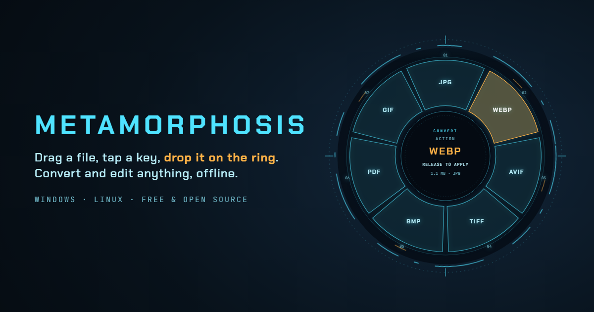
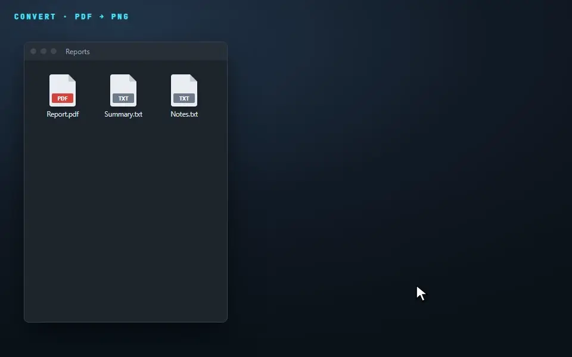
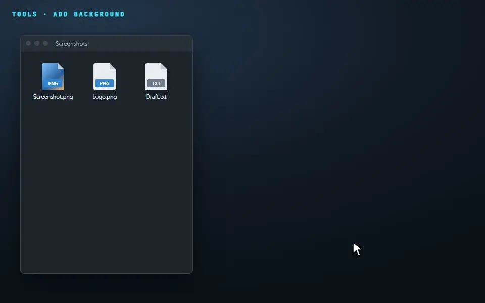
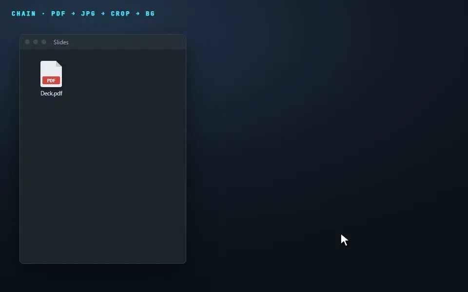
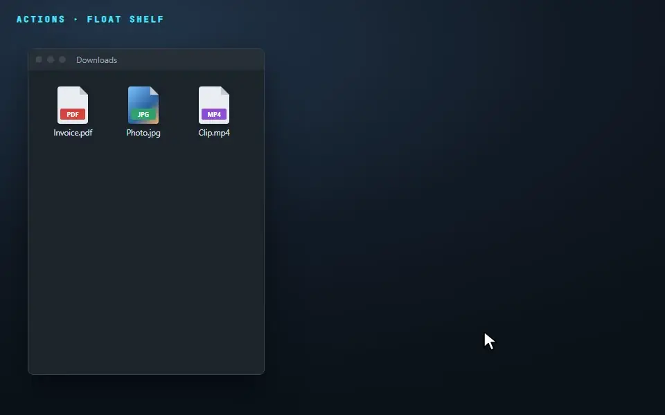
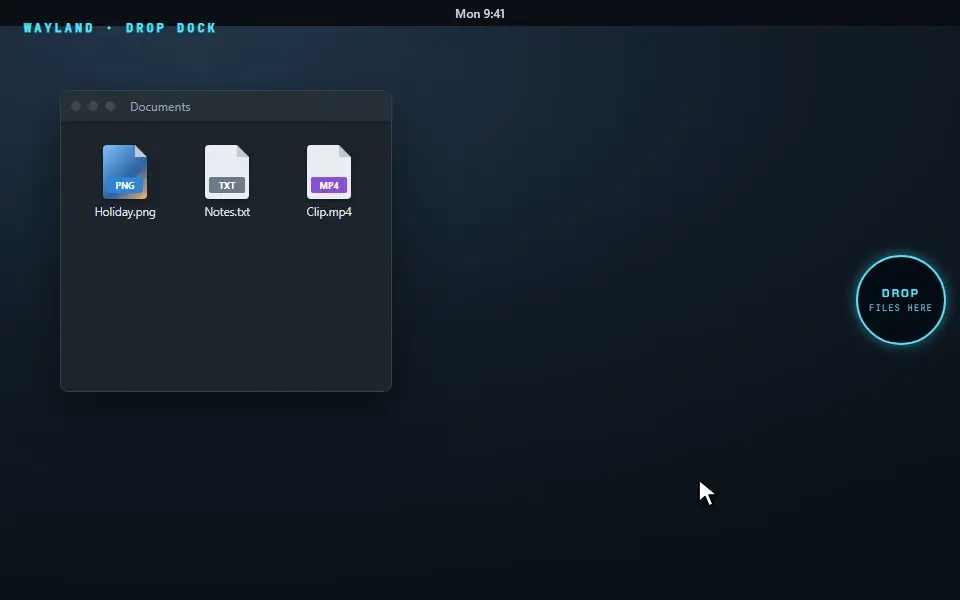

<p align="center">
  
</p>

<p align="center">
  <b>Drag a file, tap a key, drop it on the ring.</b><br>
  Convert and edit images, PDFs, video, audio and documents without opening an app. Free, open source and fully offline, on Windows and Linux.
</p>

<p align="center">
  <a href="https://github.com/medbm5/morph/releases/latest"><b>Download</b></a> ·
  <a href="https://medbm5.github.io/morph/">Website</a> ·
  <a href="#how-to-use-it">How to use it</a> ·
  <a href="#install">Install</a> ·
  <a href="https://github.com/medbm5/morph/issues">Report a bug</a>
</p>

---

## What it does

You're dragging a file anyway. Tap **Shift** mid-drag and a ring of options opens under your cursor. Drop the file on **PNG**, **Compress**, **Crop** or **Add BG**, and the result is saved next to the original.

- **Your original is never touched.** Every result is a new file: `Report.pdf` → `Report.jpg`, `Photo.jpg` → `Photo Cropped.jpg`.
- **Nothing leaves your computer.** No account, no upload, no tracking. It works offline.
- **It only shows what makes sense.** A PDF gets PDF options and a video gets video options.

## How to use it

### 1. Convert: drag, tap <kbd>Shift</kbd>, drop



Start dragging a file in Explorer (or your Linux file manager). **Tap** <kbd>Shift</kbd> once; you don't need to hold it. Keep dragging onto a format and let go.

### 2. Edit: tap <kbd>Ctrl</kbd> for tools



Compress to a target size, resize, crop, rotate, annotate, add a background, blur faces, remove a background, trim or mute a video, normalise audio, merge, split, number, watermark or password-protect PDFs and more. Tools that need adjusting open a full editor with a live preview.

### 3. Chain steps together



Drag the new file again to keep going. A chain you use often can be saved as a **recipe** from *History* and becomes its own segment on the ring.

### 4. Do things with files: tap <kbd>Alt</kbd>



Share, move to a folder, copy the path, open a terminal there, or park files on the **Float** shelf to drop them somewhere later.

### Handy keys while the ring is open

| Key | What it does |
|---|---|
| <kbd>Shift</kbd> / <kbd>Ctrl</kbd> / <kbd>Alt</kbd> | Switch between the Convert, Tools and Actions rings |
| <kbd>1</kbd>–<kbd>9</kbd> | Pick a segment without moving the mouse |
| Arrow keys + <kbd>Enter</kbd> | Move around the ring and apply |
| <kbd>Esc</kbd> | Close the ring; nothing happens |

### Other ways in

- **Right-click** a file, then choose **Metamorphosis** → *Convert… / Tools… / Actions…*
- **Select a file and press <kbd>Ctrl</kbd>+<kbd>Alt</kbd>+<kbd>M</kbd>** in Explorer.
- **Tray icon:** Settings, History, Undo, the Float shelf, and *Image from clipboard*.

### Changed your mind?

Click **UNDO** on the confirmation, or use *Tray → Undo last job*. The new file goes to the Recycle Bin. Your original was never modified.

## Install

### Windows 10 / 11

1. Open the **[latest release](https://github.com/medbm5/morph/releases/latest)**.
2. Download **`Metamorphosis_…_x64-setup.exe`** (or the `.msi`) and run it.
3. Metamorphosis starts in the system tray. Drag a file and tap <kbd>Shift</kbd>.

If SmartScreen says *"Windows protected your PC"*, click **More info → Run anyway**. The installer isn't code-signed yet.

### Linux

From the **[latest release](https://github.com/medbm5/morph/releases/latest)**:

- **Debian / Ubuntu:** `sudo apt install ./Metamorphosis_…_amd64.deb`
- **Any distribution (AppImage):** `chmod +x Metamorphosis_…_amd64.AppImage` then run it

winget, Flathub and AUR packages are being prepared.

### On Wayland (GNOME, KDE, …)

Wayland doesn't allow apps to watch your keyboard while you drag, so on Wayland you get a **drop dock** instead: a small circle at the edge of the screen. Drag files onto it and it opens into the ring. Hover *CONVERT*, *TOOLS* or *ACTIONS* to switch rings. The right-click menu works as usual, and an X11 session gives you the full experience.



### Optional extras

Some features need an extra download the first time: AI tools (remove background, blur faces, copy text from images), video and audio. Segments that need one show **INSTALL**. Click it, or open *Tray → Components…*. Everything still runs on your computer.

## Make it yours

*Tray → Settings…* lets you:

- change the trigger keys and the accent colour
- reduce animations
- choose the language (English / Français)
- pin, reorder or hide ring segments per file type
- change how output files are named and what happens when a name is taken
- start with Windows
- set up **watch folders**, where every new file is converted or compressed automatically

You can also add **your own recipes**: a small text file that runs any program you already have, such as ImageMagick or FFmpeg. See [EXTENDING.md](EXTENDING.md).

## Command line

The same engine is also available as a `morph` command (download `morph-…zip` from the release):

```sh
morph convert --to jpg report.pdf
morph tool compress --target 1MB photo.jpg
morph tool crop --ratio 1:1 photo.jpg
morph list --for clip.mov
```

## FAQ

**Does it upload my files?** No. There is no network code outside the optional-components downloader, and CI checks that.

**Where do results go?** Next to the original, with a new name. Existing files are never overwritten.

**It doesn't open when I drag.** Make sure Metamorphosis is running (tray icon), then *tap* the key. Don't hold it. On Wayland, use the drop dock.

**How do I remove the right-click menu?** Uninstalling removes it. You can also run `metamorphosis --uninstall-menus`.

## Help and contributing

Found a bug or have an idea? [Open an issue](https://github.com/medbm5/morph/issues). Want to help build it? See [CONTRIBUTING.md](CONTRIBUTING.md). The technical design is in [DESIGN.md](DESIGN.md).

---

Metamorphosis is an independent project inspired by the drag-to-convert idea of Tangerine for Mac. It is not affiliated with Tangerine or Leap Studio. Licensed under MIT or Apache-2.0.
